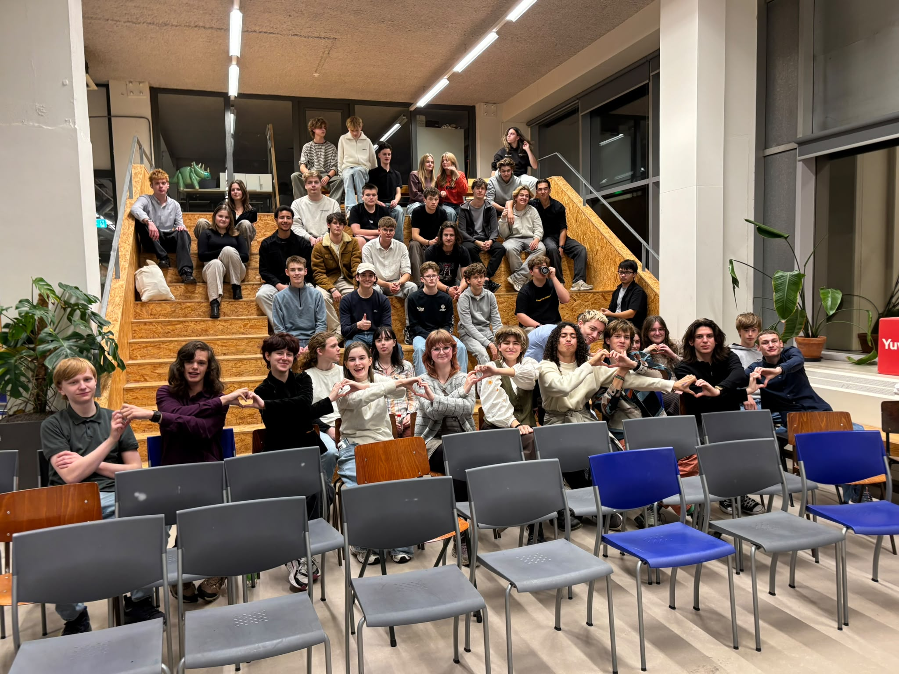
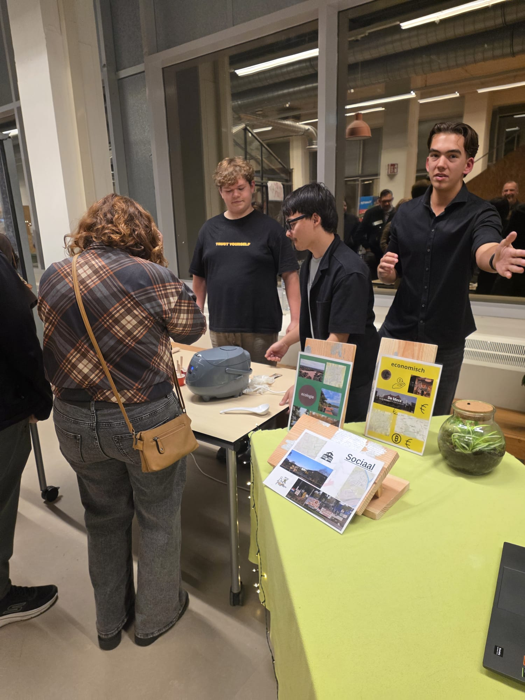

---
unlisted:
title: Reflectie voor period 1 leerjaar 1
publish: true
modified: 2026-11-06
id: rza2i0de1bsnv10gyiznoliy2rrz7s
created: 2026-11-03
aliases:
  - rza2i0de1bsnv10gyiznoliy2rrz7s
---

# Reflectie voor period 1 leerjaar 1

Naam: Dean Lemans
Klas: 1A
Period: P1 L1 Mijn leefomgeving
Docent: Gerjan, Daan, Leon, Roeland
Datum: 06-11-2026

> 0 = onvoldoende, 1 = voldoende, 2 = goed

> [!NOTE] voorwoord voor docenten
> ik had eigenlijk bij bewijs meer speciek in moeten zetten hoe ik het heb gedaan, maar eigenlijk staat alle info in het projectplan. en ik heb eigenlijk geen zin meer in om het over te typen van het projectplan

> [!note] Foto inspiratieavond
> 

---

## 1. Terugkijken op de leerdoelen

### Leerdoel 1: Effect van gedrag op ecologische, sociale en economische waarden in de eigen leefomgeving

> [!note] 1.1 Waarden in eigen woorden beschrijven
> alle drie de waarden in eigen woorden beschrijven, per waarde een kenmerk en een passend voorbeeld geven, de begrippen correct gebruiken.
>
> - Wat ik heb gedaan: *in* [tussenproduct2](<./tussenproduct2.canvas>) *en* [P1L1projectplan](<../../P1L1projectplan.pdf>)
> - Bewijs: [tussenproduct2](<./tussenproduct2.canvas>) en [P1L1projectplan](<../../P1L1projectplan.pdf>)
> - Niveau en waarom: *1, ik heb het in eigen woorden gezet, maar ik vind dat ik er niet diep genoeg op ben ingegaan*

> [!note] 1.2 De relatie tussen de waarden weergeven
> verbanden leggen tussen de drie waarden, een voorbeeld geven waarin ze elkaar beïnvloeden, laten zien dat keuzes gevolgen hebben voor meerdere waarden, een schema, model of uitleg gebruiken.
>
> - Wat ik heb gedaan: *in* [tussenproduct2](<./tussenproduct2.canvas>) *en* [P1L1projectplan](<../../P1L1projectplan.pdf>)
> - Bewijs: [tussenproduct2](<./tussenproduct2.canvas>) en [P1L1projectplan](<../../P1L1projectplan.pdf>)
> - Niveau en waarom: *2, het is op twee plekken verwerkt en ik heb feedback gevraagd*

> [!note] 1.3 Verschillende leefomgevingen met kenmerken benoemen (harde eis)
> verschillende leefomgevingen benoemen, per leefomgeving kenmerken en voorbeelden geven, onderscheid maken tussen de leefomgevingen.
>
> - Wat ik heb gedaan: *dit hebben wij als groep op de inspiratieavond gedaan*
> - Bewijs: 
> - Niveau en waarom: *2, wij hebben het uitstekend uitgelegd op de inspiratieavond*

> [!note] 1.4 De eigen leefomgeving(en) identificeren
> de eigen leefomgeving herkennen en benoemen, kenmerken beschrijven, onderbouwen waarom deze past, voorbeelden uit de eigen situatie gebruiken.
>
> - Wat ik heb gedaan: *ik heb sambal gemaakt en uitgelegd over mijn leefomgeving*
> - Bewijs: [tussenproduct_1_week_3](<./tussenproduct_1_week_3.md>) en 
> - Niveau en waarom: *2, ik heb mijn eigen leefomgeving uitgelegd en de sambal was een goed voorbeeld uit mijn eigen situatie*

> [!note] 1.5 Het effect van eigen gedrag op de leefomgeving laten zien (harde eis)
> eigen gedrag benoemen, gevolgen voor de leefomgeving beschrijven, dit koppelen aan ecologische, sociale of economische waarden, reflecteren op verbeteringen.
>
> - Wat ik heb gedaan: *ik heb het verteld op de inspiratieavond en we hebben owns daarvoor voorbereid met owns projectplan. De verbetering heb ik bij tussenproduct 2 uitgevoerd*
> - Bewijs: [P1L1projectplan](<../../P1L1projectplan.pdf>), [tussenproduct_1_week_3](<./tussenproduct_1_week_3.md>)
> - Niveau en waarom: *2, ik vond dat ik het goed had uitgelegd en verband had gelegd, en ik heb de reflectie van tussenproduct 1 verbeterd*

### Leerdoel 2: Projectmatig werken

> [!tip] 2.1 In afstemming met de opdrachtgever projectkaders opstellen (harde eis)
> wensen van de opdrachtgever inventariseren, afspraken vastleggen, doel, randvoorwaarden en verwachtingen beschrijven, kaders afstemmen met betrokkenen.
>
> - Wat ik heb gedaan: *ik heb alles gedaan van dit:* `wensen van de opdrachtgever inventariseren, afspraken vastleggen, doel, randvoorwaarden en verwachtingen beschrijven, kaders afstemmen met betrokkenen.`
> - Bewijs: [P1L1projectplan](<../../P1L1projectplan.pdf>)
> - Niveau en waarom: *als er een 3 was, zou ik mijn groepje en mezelf een 3 geven, want ik vind dat wij het uitstekend hebben gedaan*

> [!tip] 2.2 Projectdoelen SMART formuleren (harde eis)
> doelen specifiek, meetbaar, acceptabel en realistisch formuleren, met een duidelijke termijn.
>
> - Wat ik heb gedaan: `doelen specifiek, meetbaar, acceptabel en realistisch formuleren, met een duidelijke termijn.`
> - Bewijs: [P1L1projectplan](<../../P1L1projectplan.pdf>)
> - Niveau en waarom: *1, wij hadden de meeste doelen SMART geformuleerd, maar helaas niet allemaal*

> [!tip] 2.3 Het project in projectfases indelen
> projectfases benoemen, activiteiten in de juiste fase plaatsen, het doel per fase beschrijven, een logisch verloop laten zien.
>
> - Wat ik heb gedaan: *wij hebben het project in fases verdeeld in het projectplan*
> - Bewijs: [P1L1projectplan](<../../P1L1projectplan.pdf>)
> - Niveau en waarom: *1, de fases stonden erin en liepen logisch, maar ik vind dat we het doel per fase beter konden uitleggen*

> [!tip] 2.4 Een activiteitenlijst opstellen
> benodigde activiteiten benoemen die aansluiten op de doelen, een lijst die volledig, overzichtelijk en concreet is.
>
> - Wat ik heb gedaan: *wij hebben een lijst gemaakt met* `benodigde activiteiten benoemen die aansluiten op de doelen, een lijst die volledig, overzichtelijk en concreet is.`
> - Bewijs: [P1L1projectplan](<../../P1L1projectplan.pdf>)
> - Niveau en waarom: *2, wij hebben het goed uitgewerkt en voorbereid voor de inspiratieavond*

> [!tip] 2.5 Een projectplanning maken
> een realistische planning maken, deadlines en mijlpalen benoemen, activiteiten aan tijdsperioden koppelen, overzichtelijk weergeven.
>
> - Wat ik heb gedaan: *planning en deadlines gemaakt*
> - Bewijs: [planning](<../../planning.pdf>) en [P1L1projectplan](<../../P1L1projectplan.pdf>)
> - Niveau en waarom: *2, alles staat erin*

> [!tip] 2.6 Een taakverdeling maken
> taken verdelen over betrokkenen, rekening houden met kwaliteiten en verantwoordelijkheden, duidelijk beschreven, haalbaar en evenwichtig.
>
> - Wat ik heb gedaan: *wij hebben een taakverdeling gemaakt en beschreven, en de taken verdeeld over de groep*
> - Bewijs: [P1L1projectplan](<../../P1L1projectplan.pdf>)
> - Niveau en waarom: *1, de taakverdeling was haalbaar en duidelijk beschreven*

> [!tip] 2.7 Een draaiboek opstellen
> activiteiten stap voor stap beschrijven, taken, tijden, verantwoordelijkheden en benodigdheden benoemen, uitvoerbaar en overzichtelijk.
>
> - Wat ik heb gedaan: *we hebben een activiteitenlijst gemaakt*
> - Bewijs: [P1L1projectplan](<../../P1L1projectplan.pdf>)
> - Niveau en waarom: *1, het was redelijk goed gemaakt, maar kon beter. Wat miste is dat we het niet volledig stap voor stap hadden uitgewerkt*

> [!tip] 2.8 Een evaluatie van het project uitvoeren (harde eis)
> feedback verzamelen, resultaten beoordelen ten opzichte van de doelen, verbeterpunten benoemen, conclusies trekken voor een volgend project.
>
> - Wat ik heb gedaan: *dit reflectiedocument gemaakt*
> - Bewijs: dit document, [reflectie periode 1](<./reflectie periode 1.md>)
> - Niveau en waarom: *1, ik vind dat ik er well dieper op in kon gaan, maar ik heb honger en ben moe*

### Leerdoel 3: Communicatievaardigheden toepassen

> [!example] 3.1 Communication afstemmen op de behoeften en verwachtingen van de betrokkenen
> verschillende betrokkenen herkennen, rekening houden met hun behoeften en verwachtingen, taalgebruik aanpassen aan de doelgroep, controleren of de boodschap begrepen wordt.
>
> - Wat ik heb gedaan: *mijn gedrag aangepast aan de groep aan wie ik het uitlegde*
> - Bewijs: *rondvragen hoe ik mij heb gedragen op de inspiratieavond. Volgens mij had Stijn dit gedaan*
> - Niveau en waarom: *1, ik vond dat ik niet genoeg met de groep had gecommuniceerd over wat ik precies ging presenteren. Dit kwam vooral doordat ik de laatste week ziek was*

> [!example] 3.2 Communicatievorm afstemmen op het doel van het project (harde eis)
> een passende communicatievorm kiezen en toelichten, de vorm afstemmen op doelgroep en doel, de gekozen vorm effectief gebruiken.
>
> 	- Wat ik heb gedaan: *wij hebben per tweetal gepresenteerd, en hadden specifiek afgesproken wie wat gaat vertellen en waneer we mochten wisselen*
> - Bewijs: *rondvragen hoe ik mij heb gedragen op de inspiratieavond. Volgens mij had Stijn dit gedaan*
> - Niveau en waarom: *2, wij hebben goed samen gepresenteerd*

---

## 2. Waar ben je trots op?

> [!success] Trots op mijn sambal
> - Wat ik heb gedaan: *ik heb mijn eigen sambal gemaakt*
> - Gekoppeld aan succescriterium: *1.4 en 1.5*
> - Waarom ik hier trots op ben: *het was een goede sambal, mensen complimenteerden het en het paste goed bij de kernwaarde sociaal*
> - Wat dit zegt over mijn kwaliteiten: *ik kan iets uit mijn eigen leefomgeving goed overbrengen aan anderen*

> [!success] Trots op mijn verbetering bij tussenproduct 2
> - Wat ik heb gedaan: *de reflectie van tussenproduct 1 verbeterd in tussenproduct 2*
> - Gekoppeld aan succescriterium: *1.5*
> - Waarom ik hier trots op ben: *ik heb echt iets met de feedback gedaan en het werd er beter van*
> - Wat dit zegt over mijn kwaliteiten: *ik kan leren van feedback en dat zelf toepassen*

> [!success] Trots op mijn notities van de lessen [biologie_les_notities](<./biologie_les_notities.md>)
> - Wat ik heb gedaan: *ik heb goede notities gemaakt* [biologie_les_notities](<./biologie_les_notities.md>)
> - Waarom ik hier trots op ben: *ik gebruikt ze vaak en verbeter ze ook als er nieuwe informatie is*
> - Wat dit zegt over mijn kwaliteiten: *ik kan goed notities maken? goed leren bij dingen die ik interesant vind*

---

## 3. Waar wil je nog in groeien?

> [!todo] Succescriterium 1: leren groen onderzoeken
> - Waarom ik dit verder wil ontwikkelen: *omdat ik dit eigenlijk niet echt had gedaan*
> - Concrete acties: *volgende period meer focusen op onderzoek*

> [!todo] Succescriterium 2: herbarium verder verwerken
> - Waarom ik dit verder wil ontwikkelen: *dit is nuttig voor toekomstige projecten, ik kan het bijvoorbeeld erbij halen als er een relevante opdracht is*
> - Concrete acties: *het herbarium bijhouden en uitbreiden als ik nieuwe dingen leer*

---

## 4. Algemeene reflectie

> [!question] Hoe kijk ik terug op deze period?
> *Ik vond er eigenlijk niet veel aan, ik vond well dat ik en mijn groepje het goed hadden gedaan, ik vond er niet veel aan omdat ik meer geintereseert ben in groen onderzoek, en niet zoveel sociaal en die dingne, we hebben maar 1 keer wateronderzoek gehad bijvoorbeeld*

> [!question] Welk cijfer geef ik mezelf voor mijn ontwikkeling?
> *7/10, ik heb redelijk veel geleerd, maar de dingen die ik het leukst vond zijn niet terug gekomen op de inspiratieavond*

> [!question] Welk succescriterium laat het beste zien wat ik heb geleerd?
> *1.5, omdat ik daar mijn eigen gedrag heb uitgelegd en mijn reflectie heb verbeterd*

> [!question] Wat is mijn belangrijkste leerdoel voor de volgende period?
> *doe dingen die je motiveeren, dus meer focusen op onderzoek leren volgende period*
